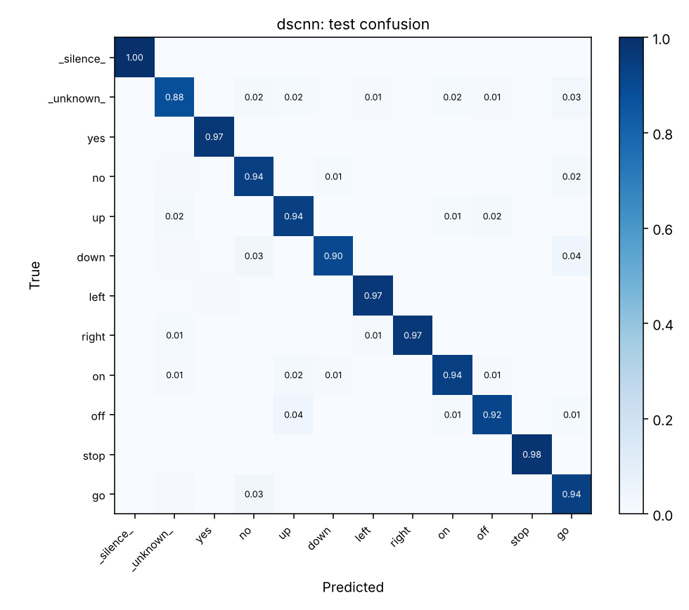
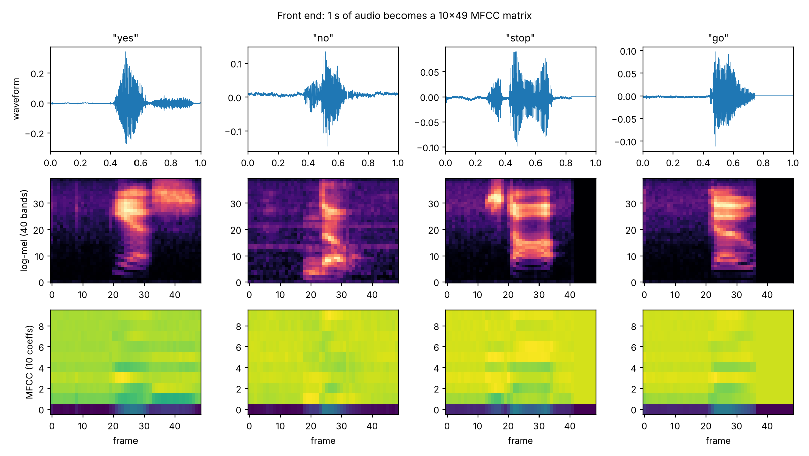

# Edge keyword spotting

An always-on wake-word spotter for Google Speech Commands V2, built to a
microcontroller budget: an MFCC front end written from the FFT up so it stays
implementable in C, a depthwise-separable CNN of ~23k parameters, and int8
quantisation with the size and latency cost measured rather than assumed.

**94.5% accuracy on the 12-class task** with a 23,180-parameter DS-CNN, from a
**49.6 KB int8 model** that runs in 0.074 ms on one CPU core. The float model
misses the 80 KB budget; the quantised one makes it.


---

## Results

Held-out test split, 4,980 clips, speakers disjoint from training.

| Model | Accuracy | Keyword accuracy | False alarms | Params | Size | p50 latency |
|---|---:|---:|---:|---:|---:|---:|
| Linear baseline | 0.4665 | 0.4480 | 0.4481 | 252 | n/a | n/a |
| DS-CNN (PyTorch) | 0.9452 | 0.9465 | 0.0607 | 23,180 | n/a | n/a |
| DS-CNN (fp32 ONNX) | 0.9452 | 0.9465 | 0.0607 | n/a | 92.5 KB | 0.067 ms |
| **DS-CNN (int8 ONNX)** | **0.9450** | 0.9433 | **0.0475** | n/a | **49.6 KB** | 0.074 ms |

94.5% is in line with published DS-CNN results on this benchmark, which is the
point of using the official splits: the number is comparable to other people's.

### Four things in that table worth reading

The baseline is not a straw man, and it fails badly. A linear model on
time-pooled MFCC statistics gets 46.7%, and false-alarms on 44.8% of
non-keyword audio, so a device that wakes up half the time it hears speech. It
is permutation-invariant over time by construction, so the gap to 94.5% is
precisely what temporal structure is worth here. The DS-CNN had already passed
it (86.6%) after one epoch.

int8 halves the model and is what makes the budget: 92.5 KB down to 49.6 KB for
0.02 percentage points of accuracy. The float model *fails* the 80 KB budget
and the quantised one passes it, which is the whole argument for quantisation
stated as a pass/fail rather than a nice-to-have.

Quantisation did not make it faster. It made it slightly slower: 0.074 ms
against 0.067 ms at p50. That is the honest measurement and it is worth
keeping: on x86 through ONNX Runtime, a QDQ graph inserts quantise/dequantise
operators around each convolution, and on a network this small that overhead
costs more than the cheaper integer arithmetic saves. On the actual target,
an MCU running CMSIS-NN int8 kernels with no float unit to fall back on, the
ordering reverses. The number here is a proxy for the target, not a
substitute, and it should not be quoted as an MCU speedup.

int8 reduced false alarms, 0.0607 down to 0.0475, while top-line accuracy fell
very slightly. Quantisation noise appears to make the model marginally less
willing to commit to a keyword. With a single run this is an observation, not
a finding. It is one seed, and the effect is small enough that it could
reverse.

### Per-class recall

| Class | Recall | | Class | Recall |
|---|---:|---|---|---:|
| `_silence_` | 0.998 | | `left` | 0.968 |
| `stop` | 0.981 | | `right` | 0.967 |
| `yes` | 0.971 | | `no` | 0.941 |
| `on` | 0.939 | | `up` | 0.936 |
| `go` | 0.935 | | `off` | 0.920 |
| `down` | 0.904 | | `_unknown_` | **0.881** |

`_silence_` is essentially solved, as it should be. The weakest class by a
clear margin is `_unknown_`, which is the honest shape of the problem: it is
an open set, twenty-five words standing in for "every word that is not a
keyword", and the model has to reject an unbounded category from a bounded
sample of it. The confusions among keywords are phonetically sensible
(`down`/`go`, `off`/`up`), not arbitrary.



---

## The task, and why it is the 12-class one

The benchmark everybody quotes is **V2-12**: ten target keywords (*yes, no,
up, down, left, right, on, off, stop, go*) plus `_silence_` and `_unknown_`.

That framing is not decoration. A wake-word system spends essentially all of
its life hearing neither a keyword nor nothing in particular: it hears the
twenty-five other words in the corpus, and it hears a room. How often it wakes
on those decides whether the device is usable, and a 35-way word-classification
accuracy skips both halves of that job. So `_unknown_` and `_silence_` are
classes here, and the false-alarm rate on them is reported separately from
accuracy.

## Splits: the defect that inflates this benchmark

Speech Commands ships `validation_list.txt` and `testing_list.txt`, which
partition the corpus by a **hash of the speaker id**. Using them is not
optional. Splitting at random instead lets the same voice saying the same word
land in both train and test, and measures speaker memorisation rather than
keyword recognition.

The pipeline uses the official lists and then **asserts** the property rather
than trusting it:

```
train   37607 examples  features (37607, 49, 10)
val      4525 examples  features (4525, 49, 10)
test     4980 examples  features (4980, 49, 10)
speakers: {'train': 2023, 'val': 246, 'test': 241}
overlaps: {'train_val': 0, 'train_test': 0, 'val_test': 0}
```

`kws data` exits non-zero if any speaker appears in two splits.

## The front end, written out

```
1 s of 16 kHz audio
  → pre-emphasis (0.97)
  → 40 ms frames, 20 ms hop, Hann window        → 49 frames
  → 1024-point rFFT, power spectrum             → 513 bins
  → 40 triangular mel filters, 20 Hz – 7.6 kHz  → 40 bands
  → log
  → orthonormal DCT-II, keep 10 coefficients    → 10 × 49
```

490 values per inference, under 2 KB in int8. That is a sane working set for
a device with 64 KB of RAM.

It is written from the FFT up rather than calling `librosa` because an
always-on spotter runs its feature extraction *on the microcontroller*,
continuously, on a battery. Whatever happens in the front end has to be a few
hundred lines of C against a CMSIS-DSP FFT, and `librosa.feature.mfcc` hides
exactly the decisions that determine whether that is possible: frame size,
FFT length, filterbank layout, how many coefficients survive.

Being hand-written, it is verified against physics rather than against another
library: a 250 Hz, 1 kHz or 3 kHz tone must peak in the mel band that contains
it; digital silence must not produce `-inf`; the geometry must yield exactly
49 frames.



### A limitation the tests pin down

Scaling a waveform multiplies every mel band's power by the same factor, which
after the log is a constant offset, which lands entirely in C0. That holds
*when every band carries real energy*, verified on broadband noise, where
halving the gain moves C0 by 8.8 and the remaining coefficients by 0.005.

It does **not** hold for speech. Speech leaves many mel bands near-empty, and
in those the log is dominated by the floor, which does not scale. So halving a
real clip's gain changes the *shape* of the feature vector, not just its
level, and the change leaks into C1 and above. The practical consequence: this
front end is not level-invariant, and a model trained at one recording gain
degrades at another. Per-utterance mean normalisation or AGC ahead of the
front end is the usual fix and is **not** implemented here. Both behaviours
are asserted in `tests/test_frontend.py` so neither can regress silently.

## The model

The model is a DS-CNN, the reference microcontroller architecture from ARM's
*Hello Edge* work. A wide first convolution spanning the MFCC axis, then four
depthwise-separable blocks, global average pooling, a linear head.

The arithmetic is the whole point: a full 3×3 convolution over C channels
costs `9·C·C` multiplies per position, a depthwise 3×3 followed by a 1×1
pointwise costs `9·C + C·C`. At 64 channels that is 36,864 against 4,672,
roughly eight times cheaper, for a small accuracy cost. On a device whose
inference budget is measured in milliwatts, that trade is obviously worth
making.

The baseline is a linear model on time-pooled MFCC statistics (mean and
standard deviation per coefficient, 252 parameters). It is there so the CNN
has to justify itself. It is also permutation-invariant over time by
construction, which makes the comparison informative: whatever the CNN gains,
it gains from temporal structure.

Augmentation is random time shift (±100 ms) and background noise mixing,
re-applied every epoch to the *waveform* rather than cached once, so the front
end sees a different signal each time. A wake word never starts exactly
at the window boundary, and a device listening in a kitchen hears a kitchen.

## Deployment budget

The budget is the Hello Edge one: **under 80 KB** of weights and **under
10 ms** per inference on one core, so a 1 Hz wake check costs well under 1%
duty cycle. `kws export` reports `PASS`/`FAIL` against it rather than leaving
the reader to judge.

Quantisation is **static** post-training int8, calibrated on real training
features. Dynamic quantisation would leave the convolutions in float, which is
most of this network.


## Reproducing

```bash
pip install -e ".[dev]"
```

```bash
make all
```

Downloads Speech Commands V2 (~2.3 GB), caches MFCC features, trains the
baseline and the DS-CNN, evaluates on the test split, exports and quantises,
and writes `reports/`. Around 30 minutes on 4 CPU cores. No GPU.

Training runs for 18 epochs with early stopping (patience 5). That budget is
chosen so a full reproduction finishes in a reasonable time on a CPU, not
because 18 is optimal; the DS-CNN reached 0.9463 validation accuracy on its
last epoch and was still improving slowly. More epochs would likely buy a few
tenths of a point.

Stages run independently:

```bash
kws data && kws train --arch dscnn && kws evaluate && kws export && kws report
```

```bash
pytest
```

## Honest limits

- A 6% false-alarm rate is too high to ship. On continuous audio that is
  a spurious wake every few minutes. Fixing it means a confidence threshold
  with a reject option and a proper detection-error trade-off curve, not a
  better argmax.
- Accuracy is measured on 1-second pre-segmented clips, which is not how a
  wake word is used. A deployed spotter runs a sliding window over continuous
  audio, and its real figure of merit is false alarms per hour against a
  detection threshold. Streaming evaluation is not implemented.
- No on-device measurement. Latency here is single-threaded x86 through
  ONNX Runtime, which is a proxy for an MCU, not a substitute. Real numbers
  need CMSIS-NN on the target part.
- int8 only. Whether this survives further compression (structured pruning,
  4-bit weights) is unexplored.
- English only, with the corpus's speaker distribution. Speech Commands skews
  towards certain accents; per-accent performance is unmeasured and is the
  kind of gap that matters for a consumer device.
- No level normalisation, as described above.

## Layout

```
src/kws/
  frontend.py   framing, mel filterbank, MFCC -- written from the FFT up
  data.py       12-class task assembly, official speaker-disjoint splits
  dataset.py    feature caching, augmentation, train-only normalisation
  models.py     DS-CNN and the linear baseline
  train.py      training loop with per-epoch re-augmentation
  evaluate.py   accuracy, per-class recall, false-alarm rates
  export.py     ONNX export, static int8 quantisation, MCU budget check
  plots.py      figures
  config.py     typed config loaded from YAML
  cli.py        `kws <stage>`
tests/          59 tests, including the speaker-leakage and front-end checks
```

## References

- Warden, *Speech Commands: a dataset for limited-vocabulary speech
  recognition*, 2018.
- Zhang, Suda, Lai & Chandra, *Hello Edge: Keyword Spotting on
  Microcontrollers*, 2017.
- Howard et al., *MobileNets: efficient convolutional neural networks for
  mobile vision applications*, 2017, for depthwise separable convolutions.

## Licence

MIT.
