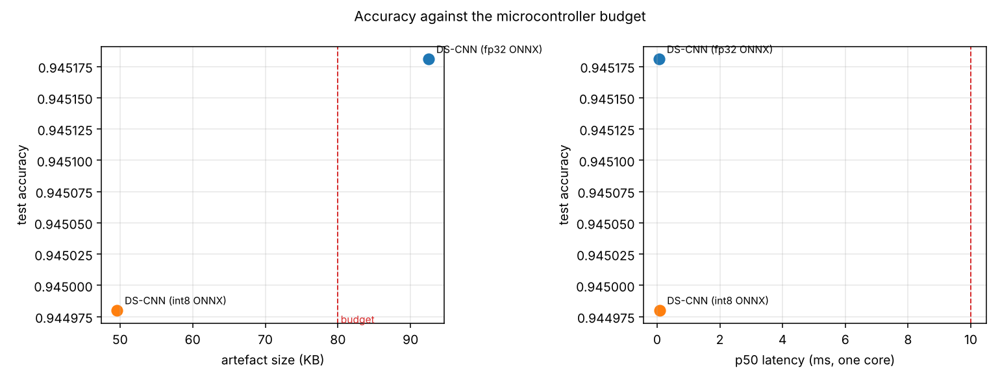

# Results

Google Speech Commands V2, 12-class task (10 keywords + `_silence_` + `_unknown_`), official speaker-disjoint splits.

| Model | Accuracy | Keyword accuracy | False alarms | Params | Size | p50 latency |
|---|---:|---:|---:|---:|---:|---:|
| dscnn | 0.9452 | 0.9465 | 0.0607 | 23,180 | n/a | n/a |
| linear | 0.4665 | 0.4480 | 0.4481 | 252 | n/a | n/a |
| DS-CNN (fp32 ONNX) | 0.9452 | 0.9465 | 0.0607 | n/a | 92 KB | 0.07 ms |
| DS-CNN (int8 ONNX) | 0.9450 | 0.9433 | 0.0475 | n/a | 50 KB | 0.07 ms |

## Per-class recall (dscnn)

| Class | Recall |
|---|---:|
| `_silence_` | 0.998 |
| `_unknown_` | 0.881 |
| `yes` | 0.971 |
| `no` | 0.941 |
| `up` | 0.936 |
| `down` | 0.904 |
| `left` | 0.968 |
| `right` | 0.967 |
| `on` | 0.939 |
| `off` | 0.920 |
| `stop` | 0.981 |
| `go` | 0.935 |

